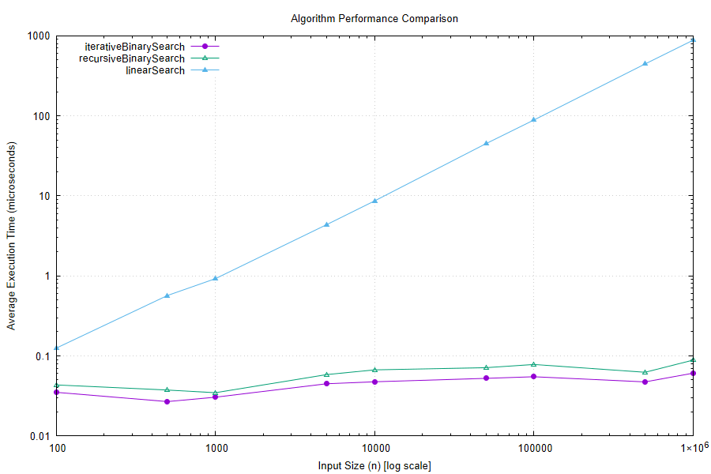

# Searching Algorithms — Performance Comparison

This folder benchmarks three searching approaches — **iterative binary search**,
**recursive binary search**, and **linear search** — across input sizes ranging
from 100 to 1,000,000 elements, and compares their real-world execution time.

## Folder contents

| File | Purpose |
|---|---|
| `iterativeBinarySearch.cpp` | Standalone source for the iterative binary search implementation |
| `recursiveBinarySearch.cpp` | Standalone source for the recursive binary search implementation |
| `linearSearch.cpp` | Standalone source for the linear search implementation |
| `performanceAnalyser.cpp` | Benchmarking harness — runs all three algorithms across a range of input sizes, times them, and outputs `results.csv` + a graph |
| `results.csv` | Raw timing data (average execution time in seconds per algorithm per input size) |
| `plot_data.dat` / `plot_script.gp` | Intermediate gnuplot data/script used to generate the graph |
| `performance_graph.png` | Log-log line chart visualizing all three algorithms side by side |

## How the benchmark works

For each input size *n*, `performanceAnalyser.cpp`:
1. Generates fresh input data (sorted, for the binary search variants; unsorted, for linear search).
2. Times each algorithm over 200 trials, using an auto-calibrated batch size so
   sub-microsecond operations (like binary search) can still be measured accurately
   despite limited system clock resolution.
3. Averages the per-call time and records it.

Results are written to `results.csv` and plotted on a log-log graph (`performance_graph.png`)
so that both slow-growing and fast-growing algorithms remain visible on the same chart.

## Results summary



| Input size (n) | Iterative Binary Search | Recursive Binary Search | Linear Search |
|---:|---:|---:|---:|
| 100 | 0.033 µs | 0.041 µs | ~0.00 µs |
| 1,000 | 0.031 µs | 0.035 µs | 0.89 µs |
| 10,000 | 0.046 µs | 0.065 µs | 8.55 µs |
| 100,000 | 0.065 µs | 0.078 µs | 86.61 µs |
| 1,000,000 | 0.052 µs | 0.088 µs | 876.41 µs |

*(values are averaged execution time per call, in microseconds; see `results.csv` for the full dataset)*

## Analysis

**Binary search — O(log n) — essentially flat.**
Both binary search variants stay under 0.1 µs across the entire range, even at
n = 1,000,000. Going from 100 to 1,000,000 elements (a 10,000x increase in size)
only doubles the search time, which is the expected signature of logarithmic growth —
at n = 1,000,000, binary search only needs about 20 comparisons.

**Iterative consistently beats recursive.**
The iterative version is roughly 1.3–1.8x faster than the recursive version at every
input size. Both do the same number of comparisons, so the gap is pure function-call
overhead: each recursive call pushes a new stack frame, while the iterative version
just loops. The gap stays proportionally consistent rather than growing, since both
scale the same way (O(log n)).

**Linear search — O(n) — scales directly with input size.**
Execution time grows roughly linearly with n, exactly as expected for a worst-case
scan (the benchmark searches for a key guaranteed *not* to be present, forcing a full
scan every time). Going from 100,000 to 1,000,000 elements (10x) roughly increases
time 10x (86.6 µs → 876.4 µs).

**The gap between approaches widens dramatically as n grows.**
At n = 100, linear search is barely measurable and close to binary search. By
n = 1,000,000, linear search is over 16,000x slower than iterative binary search.
This is the core takeaway of the comparison: for large, sortable datasets that will
be searched repeatedly, the one-time cost of sorting is almost always worth it —
binary search's O(log n) growth makes it essentially insensitive to dataset size,
while linear search's O(n) growth makes it increasingly expensive.

## Regenerating results

```bash
g++ performanceAnalyser.cpp -o performanceAnalyser
./performanceAnalyser
```

This overwrites `results.csv`, `plot_data.dat`, `plot_script.gp`, and
`performance_graph.png` with a fresh run. Producing the PNG requires
[gnuplot](http://www.gnuplot.info/) to be installed and available on your PATH.