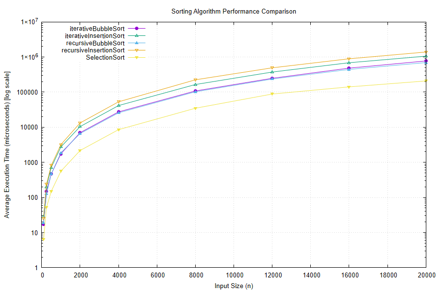

# Sorting Algorithms — Performance Comparison

This folder benchmarks five sorting approaches — **iterative bubble sort**,
**iterative insertion sort**, **recursive bubble sort**, **recursive insertion sort**,
and **selection sort** — across input sizes ranging from 100 to 20,000 elements,
and compares their real-world execution time.

## Folder contents

| File | Purpose |
|---|---|
| `sort_performance_analyzer.cpp` | Benchmarking harness — runs all five algorithms across a range of input sizes, times them, and outputs `results.csv` + a graph. Contains all five sort implementations inline. |
| `results.csv` | Raw timing data (average execution time in seconds per algorithm per input size) |
| `plot_data.dat` / `plot_script.gp` | Intermediate gnuplot data/script used to generate the graph |
| `performance_graph.png` | Line chart visualizing all five algorithms side by side (log-scale y-axis) |

## How the benchmark works

For each input size *n*, `sort_performance_analyzer.cpp`:
1. Generates one fixed unsorted array per input size (same seed, so every algorithm
   sorts identical data at a given *n*).
2. Before **every single timed call**, copies that array fresh. Sorting is
   destructive — unlike a search benchmark, reusing the same array across trials
   would mean trial 2 onward times a sort on already-sorted data — so each call
   gets its own unsorted copy.
3. Times each algorithm over 50 trials, using an auto-calibrated batch size so
   fast calls at small *n* can still be measured accurately despite limited
   system clock resolution.
4. Averages the per-call time and records it.

Results are written to `results.csv` and plotted on a log-scale graph
(`performance_graph.png`) so that both cheap and expensive algorithms remain
visible on the same chart.

## Results summary



| Input size (n) | Iterative Bubble | Iterative Insertion | Recursive Bubble | Recursive Insertion | Selection Sort |
|---:|---:|---:|---:|---:|---:|
| 100 | 17.2 µs | 28.4 µs | 18.8 µs | 25.0 µs | 6.4 µs |
| 250 | 149.3 µs | 199.0 µs | 125.4 µs | 240.7 µs | 52.0 µs |
| 500 | 466.4 µs | 720.5 µs | 468.9 µs | 821.2 µs | 150.3 µs |
| 1,000 | 1,753.5 µs | 2,747.4 µs | 1,869.3 µs | 3,213.0 µs | 559.0 µs |
| 2,000 | 6,989.8 µs | 10,444.6 µs | 6,604.8 µs | 13,264.6 µs | 2,174.7 µs |
| 4,000 | 27,348.9 µs | 41,467.5 µs | 25,725.1 µs | 52,999.0 µs | 8,530.6 µs |
| 8,000 | 107,951.0 µs | 164,896.0 µs | 102,298.0 µs | 224,612.0 µs | 34,789.9 µs |
| 12,000 | 247,900.0 µs | 373,695.0 µs | 236,165.0 µs | 493,125.0 µs | 88,367.0 µs |
| 16,000 | 483,732.0 µs | 687,968.0 µs | 443,989.0 µs | 891,546.0 µs | 141,105.0 µs |
| 20,000 | 772,669.0 µs | 1,059,370.0 µs | 694,654.0 µs | 1,390,710.0 µs | 208,379.0 µs |

*(values are averaged execution time per call, in microseconds; see `results.csv` for the full dataset)*

## Analysis

**All five are O(n²) — and it shows.**
Every algorithm's time roughly quadruples each time *n* doubles (e.g. selection
sort: 34,789.9 µs at n=8,000 → 141,105.0 µs at n=16,000, a ~4.06x increase for
a 2x input). This is the expected signature of quadratic growth: unlike binary
search's near-flat curve, none of these algorithms stay usable much past tens
of thousands of elements.

**Selection sort is the clear winner, despite being O(n²) too.**
At every size, selection sort runs 3.5–5.4x faster than the next-best
algorithm — at n=20,000 it finishes in ~208 ms versus ~695 ms–1.4 s for the
rest. The reason isn't its comparison count (still O(n²), same as bubble/
insertion) but its swap count: selection sort does at most one swap per outer
iteration (O(n) swaps total), while bubble and insertion sort swap on nearly
every comparison that finds elements out of order (O(n²) swaps on random
data). Swaps cost more than comparisons, so fewer of them wins.

**Insertion sort: iterative reliably beats recursive, by a growing margin.**
Recursive insertion sort starts only slightly slower at n=100, but by n=8,000
it's running ~36% slower than the iterative version, and stays 30%+ slower
through n=20,000. Both do the same shifting work, so the gap is call overhead
— and unlike binary search's O(log n) call depth, this recursion is O(n) deep
(one call per element), so a small per-call cost compounds across every
single element rather than staying negligible.

**Bubble sort: recursive is roughly on par with — and at larger n, slightly
faster than — iterative.** This is the more surprising result. At small n
(≤1,000) iterative edges out recursive, but the two swap places by n=4,000,
and by n=20,000 recursive bubble sort (694,654 µs) is running ~10% *faster*
than iterative (772,669 µs). A likely explanation: `recursiveBubbleSort`'s
self-call is in tail position (the very last statement in the function), so
at `-O2` the compiler can plausibly turn it into a plain loop via tail-call
optimization, erasing most of the call overhead you'd otherwise expect.
`recursiveInsertionSort`'s call is *also* in tail position, so this alone
doesn't fully explain why insertion sort's recursive version doesn't get the
same benefit — the difference may come down to how the compiler optimizes
`vector<int>&` indexing versus raw-pointer array access, or other
implementation details that would need a look at the generated assembly to
confirm.

**Recursion depth is a real practical concern regardless of speed.**
Both recursive variants recurse once per remaining element, so sorting n
elements means an *n*-deep call stack (tail-call optimization at `-O2` may
avoid growing the actual native stack, but that's a compiler favor, not a
language guarantee — an unoptimized build or a different compiler could still
overflow). This benchmark's range (up to 20,000) ran fine, but scaling these
recursive versions up much further isn't safe to assume will keep working.

**Takeaway.**
For any of these five, sorted output doesn't come cheap at scale — all are
firmly quadratic. Selection sort is the clear practical choice among them
thanks to its low swap count. If large inputs are a possibility, none of
these five are the right choice — an O(n log n) algorithm (merge sort,
quicksort, `std::sort`) would be needed instead.

## Regenerating results

```bash
g++ -O2 -std=c++17 sort_performance_analyzer.cpp -o sort_performance_analyzer
./sort_performance_analyzer
```

This overwrites `results.csv`, `plot_data.dat`, `plot_script.gp`, and
`performance_graph.png` with a fresh run. Producing the PNG requires
[gnuplot](http://www.gnuplot.info/) to be installed and available on your PATH.

Note: the default `input_sizes` in the harness go up to 20,000 elements across
5 algorithms at 50 trials each — because every algorithm here is O(n²), this
full run takes a few minutes (the results above were produced this way). Trim
`input_sizes` or lower `TRIALS_PER_SIZE` in the `EDIT HERE` sections of the
`.cpp` file for a quicker pass.