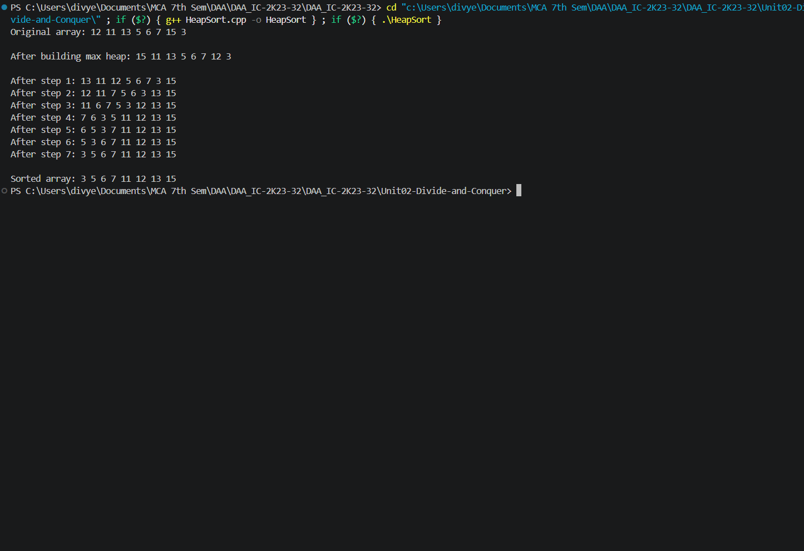
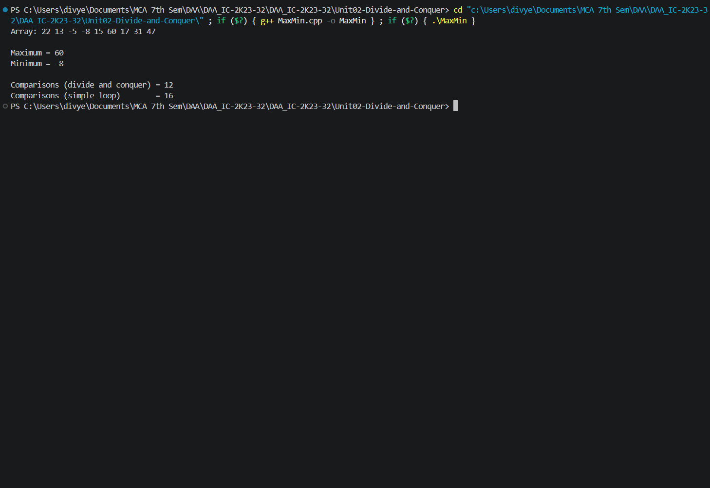
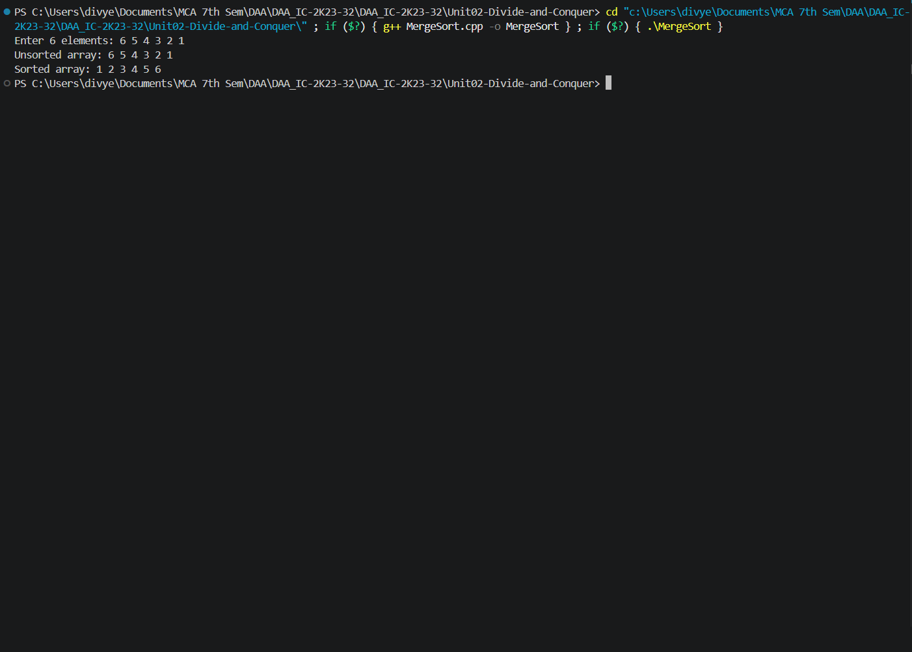
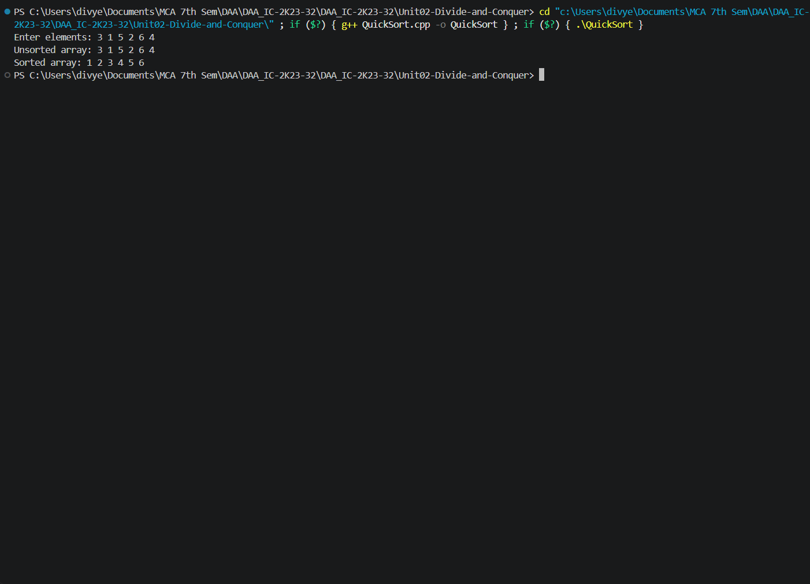

# Unit 02 — Divide and Conquer

This unit covers heap-based sorting, divide-and-conquer array analysis, sorting algorithms, and fast matrix multiplication.

**Progressive version:** 2 — 4 of 5 programs documented.

## Programs

### 1. Heap Sort (`HeapSort.cpp`)

**Approach:** Builds a max heap, repeatedly moves the largest element to the end, and restores the heap property with `heapify()`.

- **Time complexity:** O(n log n)
- **Space complexity:** O(log n) recursion stack for `heapify()`; the heap itself is in-place.
- **Program behavior:** Uses a predefined array and displays the original array, heap construction/extraction steps, and final sorted array.

**Output:**



*Output screenshot: `Outputs/HeapSort.png`*

### 2. Maximum and Minimum using Divide and Conquer (`MaxMin.cpp`)

**Approach:** Recursively divides the array into two halves, finds each half's maximum and minimum, then combines the results. One-element and two-element ranges are handled as base cases.

- **Time complexity:** O(n)
- **Space complexity:** O(log n) recursion stack.
- **Program behavior:** Uses a predefined array and prints the maximum, minimum, and comparison counts (including a simple-loop baseline).

**Output:**



*Output screenshot: `Outputs/MaxMin.png`*

### 3. Merge Sort (`MergeSort.cpp`)

**Approach:** Recursively splits the array into halves and merges the sorted halves using a temporary vector.

- **Time complexity:** O(n log n) in best, average, and worst cases.
- **Space complexity:** O(n) auxiliary space for merging, plus O(log n) recursion stack.
- **Program behavior:** Reads 6 integers from standard input and prints the original and sorted arrays.

**Output:**



*Output screenshot: `Outputs/MergeSort.png`*

### 4. Quick Sort (`QuickSort.cpp`)

**Approach:** Uses the first element as pivot, partitions the range around it, and recursively sorts the two partitions.

- **Time complexity:** Average: O(n log n); worst: O(n²).
- **Space complexity:** Average: O(log n) recursion stack; worst: O(n).
- **Program behavior:** Reads 6 integers from standard input and prints the original and sorted arrays.

**Output:**



*Output screenshot: `Outputs/QuickSort.png`*

## Compile and run

Compile an individual source file using a C++17 compiler:

```bash
g++ -std=c++17 ProgramName.cpp -o program
./program
```

On Windows PowerShell:

```powershell
g++ -std=c++17 ProgramName.cpp -o program.exe
.\program.exe
```

Replace `ProgramName.cpp` with the source file you want to run. Programs that request input will prompt in the terminal; others use sample data defined in the source.

## Notes

- Each C++ source file is a standalone program and should be compiled separately.
- Output images are stored in the adjacent `Outputs/` folder and are embedded using relative Markdown paths.