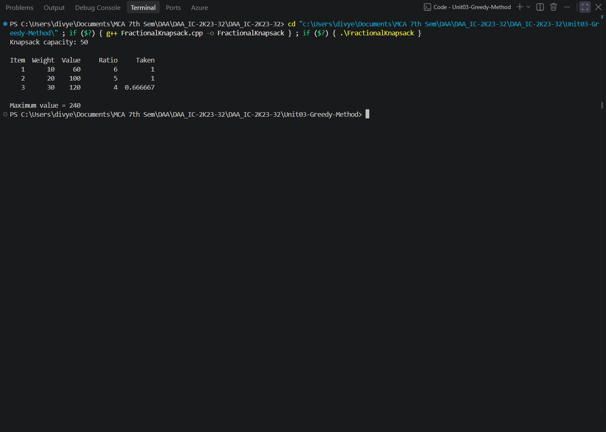
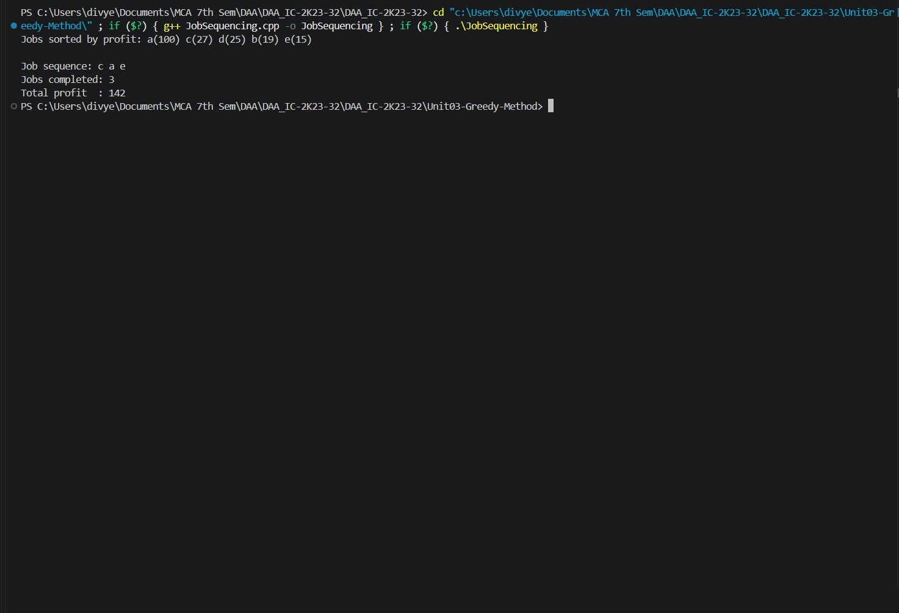
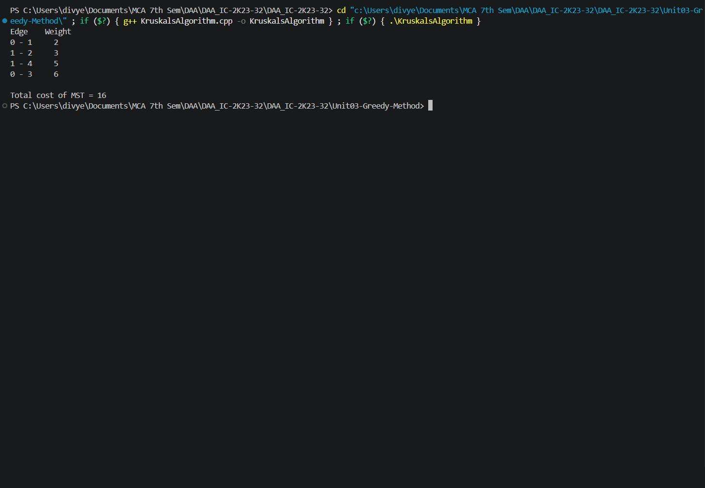
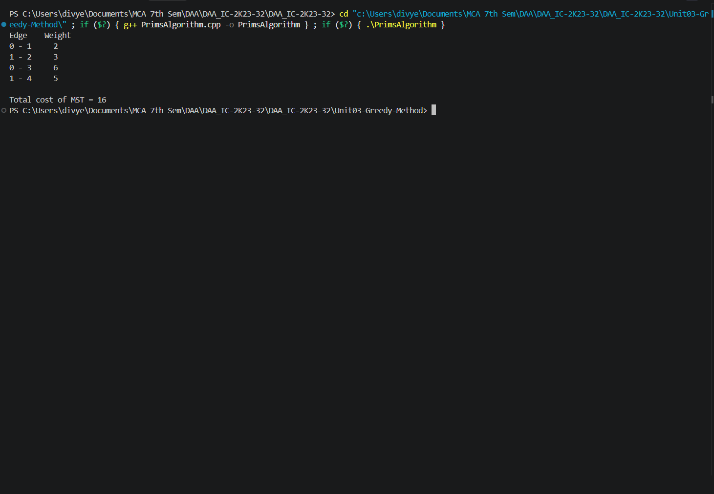

# Unit 03 — Greedy Method

This unit covers greedy optimization techniques, job scheduling, and minimum spanning tree algorithms.

**Progressive version:** 4 — 4 programs documented.

## Programs

### 1. Fractional Knapsack (`FractionalKnapsack.cpp`)

**Approach:** Computes each item's value-to-weight ratio, sorts items by descending ratio, and takes a whole item or the fraction that fits until the capacity is full.

- **Time complexity:** O(n log n) due to sorting.
- **Space complexity:** O(n) for item storage and sorting support.
- **Program behavior:** Uses predefined items and capacity; prints ratios, fractions taken, and maximum total value.

**Output:**



*Output screenshot: `Outputs/FractionalKnapsack.png`*


### 2. Job Sequencing with Deadlines (`JobSequencing.cpp`)

**Approach:** Sorts jobs by descending profit and schedules each job in the latest free slot at or before its deadline.

- **Time complexity:** O(n log n + nD), where D is the maximum deadline; worst case O(n²) when D = O(n).
- **Space complexity:** O(D) for the scheduling slots.
- **Program behavior:** Uses predefined jobs and prints the sorted jobs, selected sequence, completed job count, and total profit.

**Output:**



*Output screenshot: `Outputs/JobSequencing.png`*


### 3. Kruskal's Minimum Spanning Tree (`KruskalsAlgorithm.cpp`)

**Approach:** Sorts edges by increasing weight and adds an edge only if its endpoints belong to different disjoint sets, preventing cycles.

- **Time complexity:** O(E log E), dominated by edge sorting; disjoint-set operations are near-constant amortized.
- **Space complexity:** O(V) for the disjoint-set parent structure, excluding the edge list.
- **Program behavior:** Uses a predefined weighted graph and prints the MST edges and total cost.

**Output:**



*Output screenshot: `Outputs/Kruskal.png`*


### 4. Prim's Minimum Spanning Tree (`PrimsAlgorithm.cpp`)

**Approach:** Starts at vertex 0 and repeatedly adds the not-yet-included vertex with the smallest key, updating neighboring keys and parent links.

- **Time complexity:** O(V²) with the adjacency-matrix implementation.
- **Space complexity:** O(V²) for the graph matrix and O(V) for supporting arrays.
- **Program behavior:** Uses a predefined weighted graph and prints the MST edges and total cost.

**Output:**



*Output screenshot: `Outputs/Prims.png`*


## Compile and run

Compile an individual source file using a C++17 compiler:

```bash
g++ -std=c++17 ProgramName.cpp -o program
./program
```

On Windows PowerShell:

```powershell
g++ -std=c++17 ProgramName.cpp -o program.exe
.\program.exe
```

Replace `ProgramName.cpp` with the source file you want to run. Programs that request input will prompt in the terminal; others use sample data defined in the source.

## Notes

- Each C++ source file is a standalone program and should be compiled separately.
- Output images are stored in the adjacent `Outputs/` folder and are embedded using relative Markdown paths.
- Keep the `Outputs/` folder alongside `README.md` so images render correctly on GitHub.
