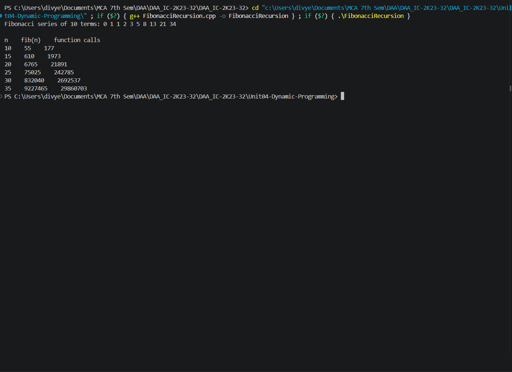
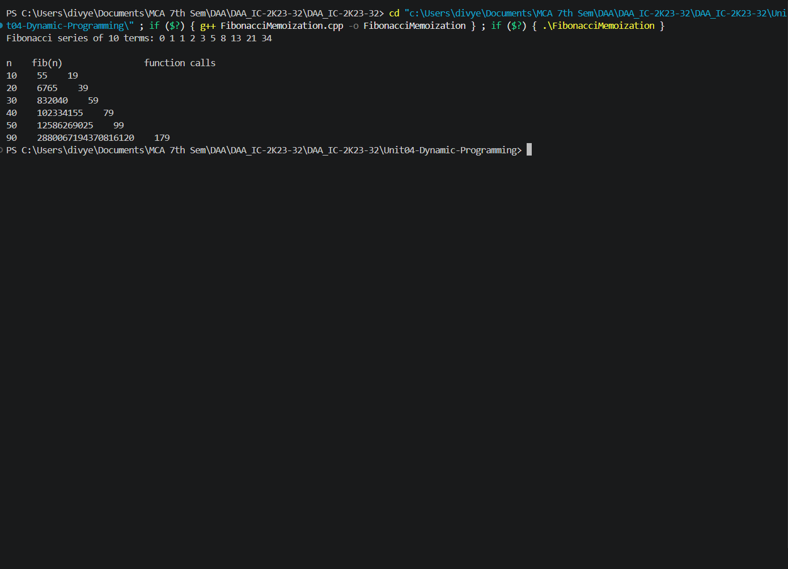
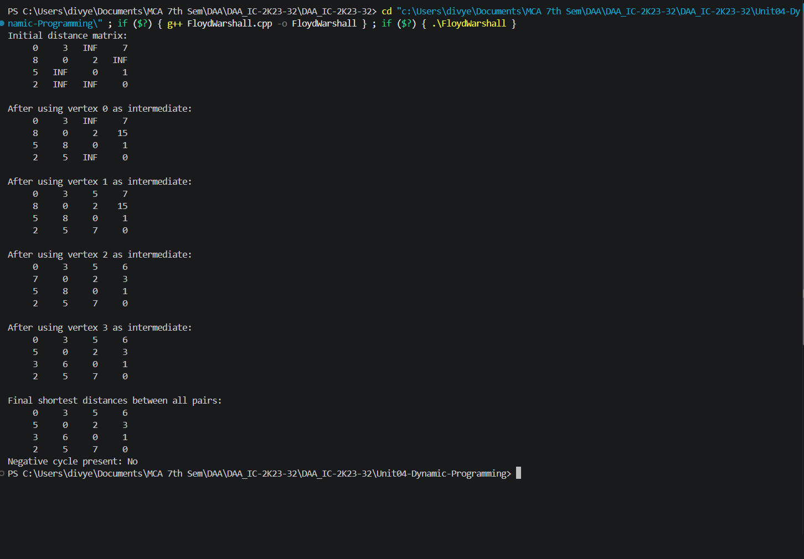
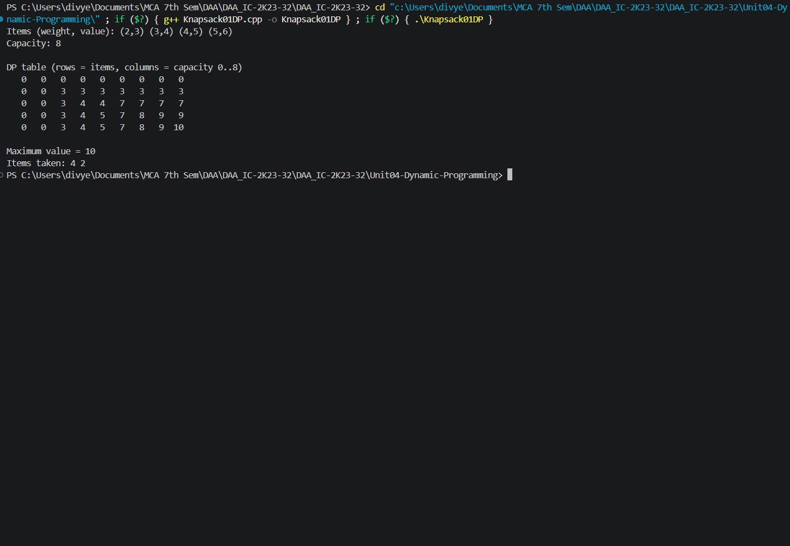
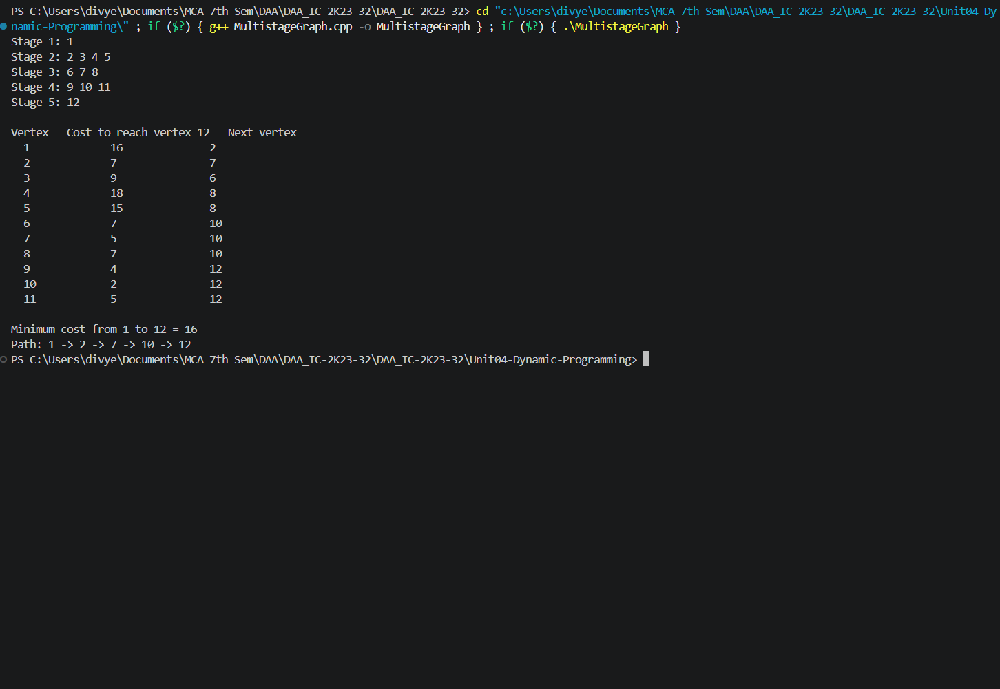
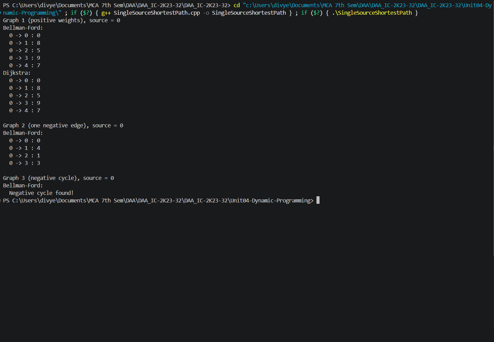
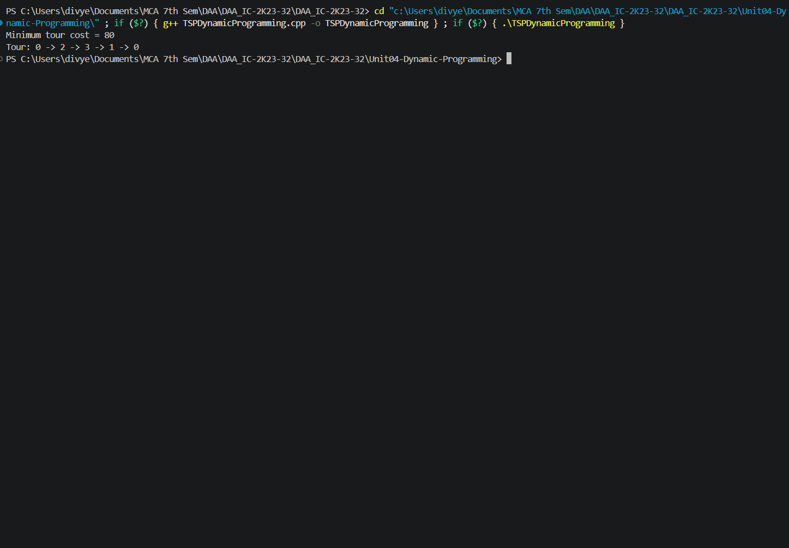

# Unit04-Dynamic-Programming

This unit implements dynamic programming techniques for overlapping subproblems and optimization, including Fibonacci computation, shortest paths, knapsack, multistage graphs, and the Travelling Salesperson Problem.

## Programs

### Fibonacci using Recursion — `FibonacciRecursion.cpp`

**How it works:** Computes each Fibonacci term by recursively calling `fib(n-1) + fib(n-2)`. It deliberately recomputes overlapping subproblems and counts function calls to illustrate the cost of plain recursion.

- **Time complexity:** `O(2^n) time (exponential; a tighter bound is Θ(φ^n))`
- **Auxiliary space:** `O(n) recursion stack`
- **Program behavior:** Prints the first 10 Fibonacci terms and reports results and function-call counts for n = 10, 15, 20, 25, 30, and 35.

**Sample output**



*Screenshot: `FibonacciRecursion.png`*

### Fibonacci using Memoization — `FibonacciMemoization.cpp`

**How it works:** Uses top-down dynamic programming: stores each computed Fibonacci value in a memo array and reuses it instead of solving the same subproblem again.

- **Time complexity:** `O(n) time for one `fib(n)` evaluation`
- **Auxiliary space:** `O(n) memo storage and O(n) recursion stack`
- **Program behavior:** Prints the first 10 terms and function-call counts for n = 10, 20, 30, 40, 50, and 90.

**Sample output**



*Screenshot: `FibonacciMemoization.png`*

### Floyd–Warshall Algorithm — `FloydWarshall.cpp`

**How it works:** Finds shortest paths between every pair of vertices. It repeatedly considers each vertex as an intermediate point and updates `dist[i][j]` when routing through that vertex is cheaper. It also checks the diagonal for a negative cycle.

- **Time complexity:** `O(V³) time`
- **Auxiliary space:** `O(V²) for the distance matrix`
- **Program behavior:** Uses a predefined 4-vertex weighted directed graph; prints the initial matrix, the matrix after each intermediate vertex, final all-pairs distances, and negative-cycle status.

**Sample output**



*Screenshot: `FloydWarshall.png`*

### 0/1 Knapsack using Dynamic Programming — `Knapsack01DP.cpp`

**How it works:** Builds a DP table where each state represents the best value achievable using the first i items and capacity w. For each item it chooses between including and excluding it, then backtracks through the table to identify selected items.

- **Time complexity:** `O(nW), where W is the knapsack capacity`
- **Auxiliary space:** `O(nW) for the DP table`
- **Program behavior:** Uses 4 predefined items and capacity 8; prints the item list, full DP table, maximum value, and selected item indices.

**Sample output**



*Screenshot: `Knapsack01DP.png`*

### Multistage Graph Shortest Path — `MultistageGraph.cpp`

**How it works:** Computes the minimum-cost path from source vertex 1 to sink vertex 12 in a directed multistage graph. It works backward from the sink, storing each vertex’s minimum remaining cost and the next vertex on the optimal path.

- **Time complexity:** `O(V²) in this implementation because each vertex scans possible later vertices`
- **Auxiliary space:** `O(V²) for the cost matrix, plus O(V) arrays`
- **Program behavior:** Uses a predefined 5-stage, 12-vertex graph; prints the stages, cost-to-sink and next-vertex table, minimum path cost, and selected path.

**Sample output**



*Screenshot: `MultistageGraph.png`*

### Single-Source Shortest Path: Bellman–Ford and Dijkstra — `SingleSourceShortestPath.cpp`

**How it works:** Implements two algorithms. Bellman–Ford relaxes all edges V−1 times and performs an extra pass to detect reachable negative cycles. Dijkstra repeatedly finalizes the nearest unfinished vertex and relaxes its outgoing edges; it is used only for non-negative weights.

- **Time complexity:** `Bellman–Ford: O(VE); Dijkstra: O(V²) here (matrix/linear minimum selection)`
- **Auxiliary space:** `O(V) for Bellman–Ford; O(V²) for Dijkstra’s adjacency matrix`
- **Program behavior:** Runs Bellman–Ford and Dijkstra on a positive-weight graph, Bellman–Ford on a graph with a negative edge, and Bellman–Ford on a graph containing a reachable negative cycle.

**Sample output**



*Screenshot: `SingleSourceShortestPath.png`*

### Travelling Salesperson Problem using Dynamic Programming (Held–Karp) — `TSPDynamicProgramming.cpp`

**How it works:** Uses bitmask DP. `dp[mask][i]` stores the minimum cost to start at city 0, visit exactly the cities in `mask`, and finish at city i. A parent table reconstructs the optimal tour, which returns to city 0.

- **Time complexity:** `O(n²·2ⁿ) time`
- **Auxiliary space:** `O(n·2ⁿ) for DP and parent tables`
- **Program behavior:** Uses a predefined 4-city distance matrix; prints the minimum tour cost and the reconstructed tour.

**Sample output**



*Screenshot: `TSPDynamicProgramming.png`*

## Compile and run

Compile each source file separately with a C++17 compiler. Run the command from the repository root (or adjust the relative path if you are already inside the unit folder).

```bash
g++ -std=c++17 path/to/Program.cpp -o program
./program
```

On Windows PowerShell:

```powershell
g++ -std=c++17 path/to/Program.cpp -o program.exe
.\program.exe
```

Replace `path/to/Program.cpp` with the required source-file path. Most programs use predefined sample data; `NQueens.cpp` asks the user to enter N.

## Notes

- Each `.cpp` file is a standalone program; compile it independently.
- Output screenshots are embedded from the unit's `outputs/` directory (or the relevant subfolder in Unit 5). Keep the image folders in place when moving or publishing the README.

## Complexity notation

- `n` = number of items, Fibonacci index, or cities as appropriate.
- `V` = number of graph vertices, `E` = number of graph edges, and `W` = knapsack capacity.
