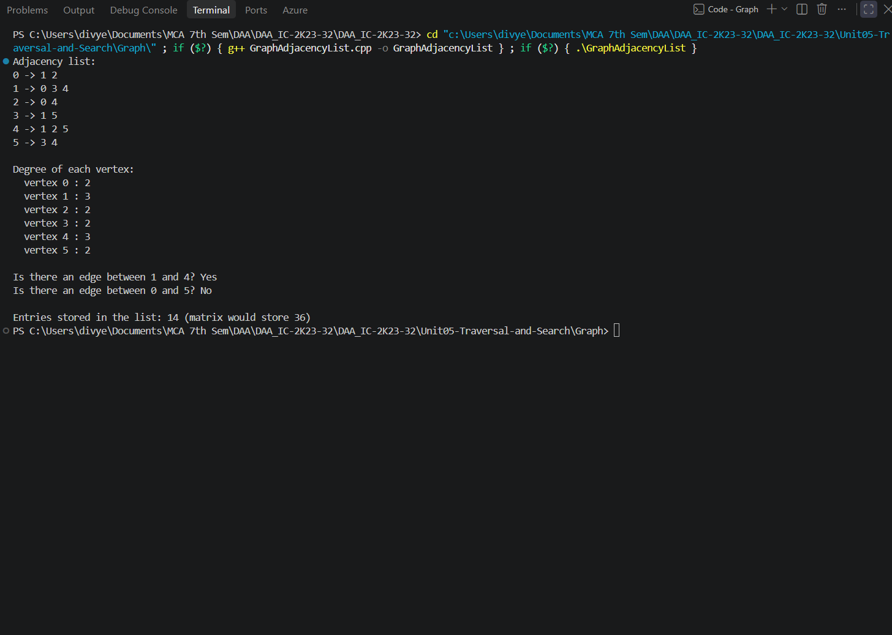
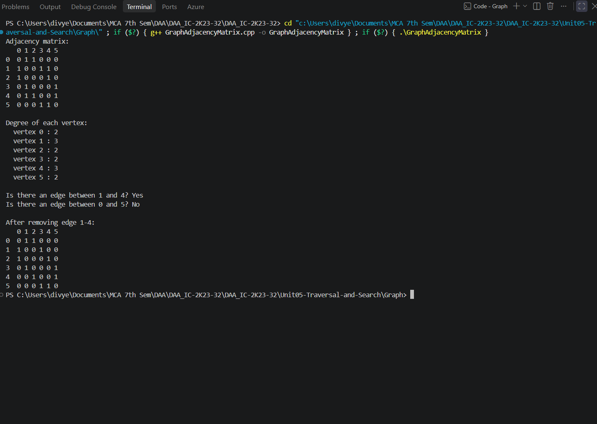
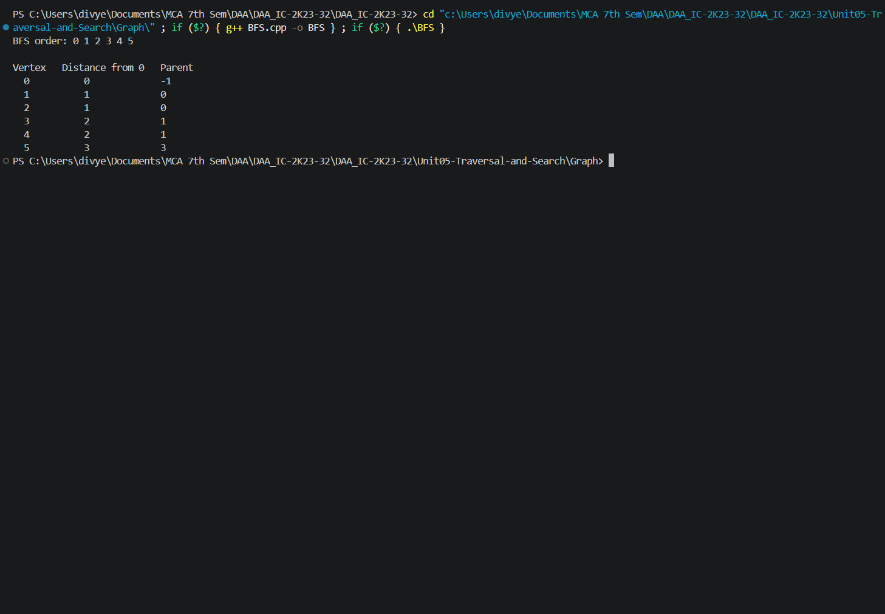
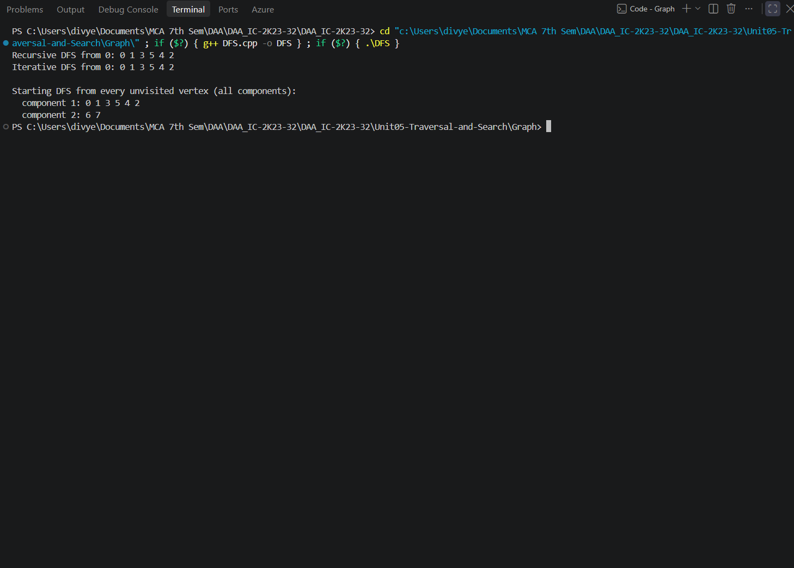
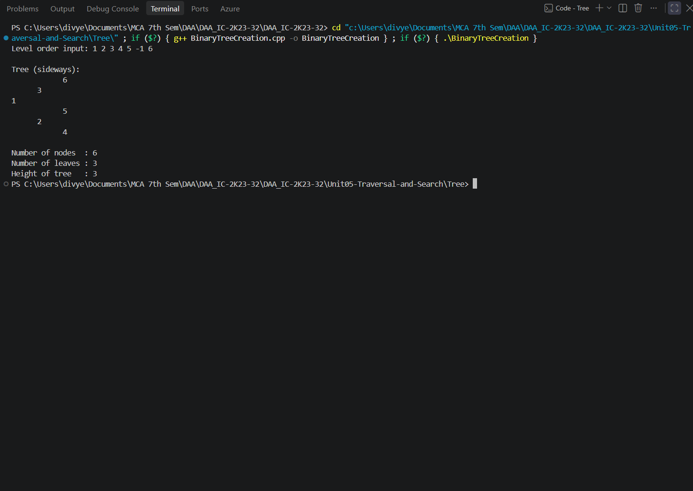
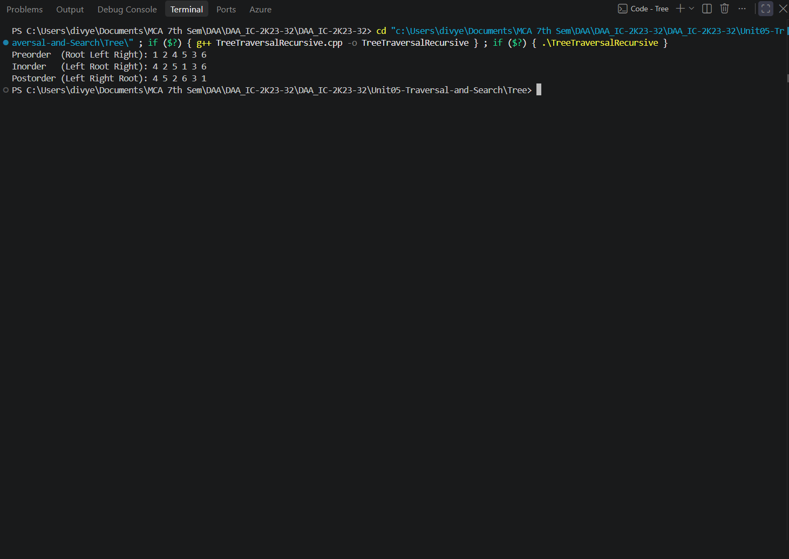
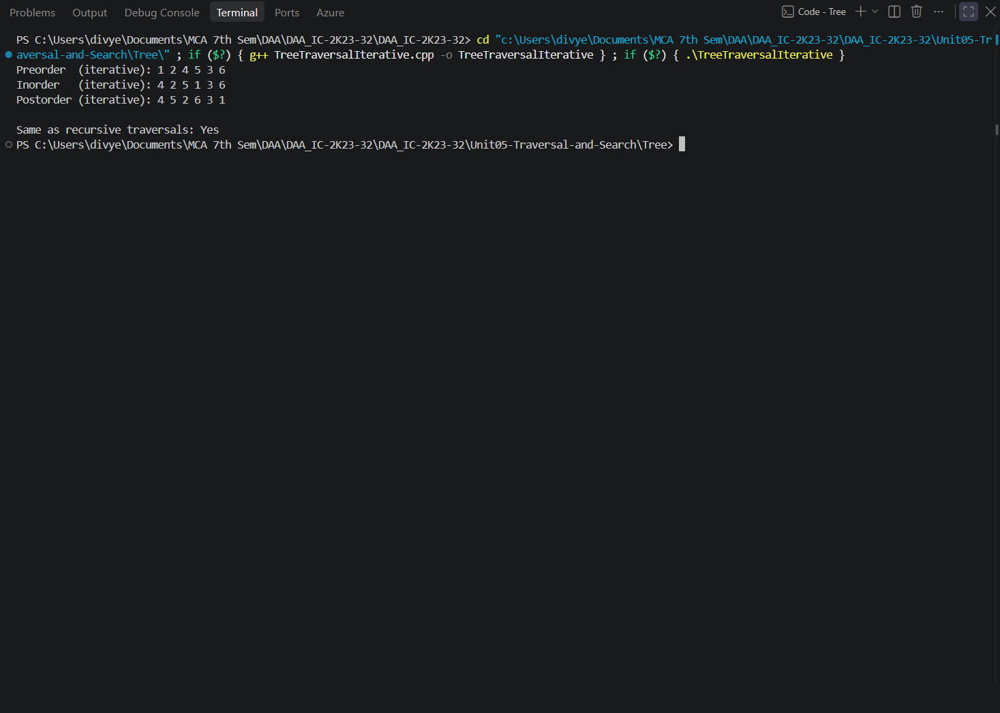

# Unit05-Traversal-and-Search

This unit covers graph representations, graph traversal algorithms, binary tree construction, and recursive and iterative tree traversals. Programs are organized into `Graph/` and `Tree/` subfolders.

## Programs

### Graph Representation using Adjacency List — `Graph/GraphAdjacencyList.cpp`

**How it works:** Stores each vertex’s neighbors in a vector. Since the graph is undirected, every edge is inserted in both endpoint lists. The program also calculates degrees and checks whether selected edges exist.

- **Time complexity:** `O(V + E) to build and print the representation; O(degree(v)) for `hasEdge(v, u)``
- **Auxiliary space:** `O(V + E)`
- **Program behavior:** Builds a predefined 6-vertex graph and prints its adjacency list, vertex degrees, two edge-existence checks, and the number of stored adjacency entries.

**Sample output**



*Screenshot: `GraphAdjacencyList.png`*

### Graph Representation using Adjacency Matrix — `Graph/GraphAdjacencyMatrix.cpp`

**How it works:** Stores edges in a V×V matrix. An entry is 1 when an edge exists and 0 otherwise. The program demonstrates adding and removing undirected edges, printing the matrix, and calculating degrees.

- **Time complexity:** `O(V²) to initialize/print the matrix; O(1) to test or update an edge`
- **Auxiliary space:** `O(V²)`
- **Program behavior:** Builds a predefined 6-vertex graph, prints its matrix and degrees, checks two edges, removes edge 1–4, and prints the updated matrix.

**Sample output**



*Screenshot: `GraphAdjacencyMatrix.png`*

### Breadth-First Search (BFS) — `Graph/BFS.cpp`

**How it works:** Visits vertices level by level using a FIFO queue. It marks vertices when enqueued and records each vertex’s distance in edges and parent in the BFS tree.

- **Time complexity:** `O(V + E) with an adjacency list`
- **Auxiliary space:** `O(V) auxiliary space, excluding the graph`
- **Program behavior:** Runs BFS from vertex 0 on a predefined 6-vertex undirected graph; prints traversal order, distance from the start, and parent for each vertex.

**Sample output**



*Screenshot: `BFS.png`*

### Depth-First Search (DFS) — `Graph/DFS.cpp`

**How it works:** Implements recursive DFS using the call stack and iterative DFS using an explicit stack. It resets visited state between runs and finally starts DFS from every unvisited vertex to cover disconnected components.

- **Time complexity:** `O(V + E) with an adjacency list`
- **Auxiliary space:** `O(V) for visited state and traversal stack/recursion`
- **Program behavior:** Runs both DFS variants from vertex 0, then traverses every connected component of a predefined 8-vertex graph (vertices 6 and 7 form a separate component).

**Sample output**



*Screenshot: `DFS.png`*

### Binary Tree Creation — `Tree/BinaryTreeCreation.cpp`

**How it works:** Creates a binary tree level by level from an array. A queue tracks the next node whose left and right children should be assigned; `-1` represents a missing child. It also prints the tree sideways and calculates structural properties.

- **Time complexity:** `O(n) to construct and inspect the tree`
- **Auxiliary space:** `O(n) for allocated nodes and queue; O(h) recursion stack for recursive helpers`
- **Program behavior:** Builds the tree from `{1, 2, 3, 4, 5, -1, 6}` and prints the input, sideways tree, node count, leaf count, and height.

**Sample output**



*Screenshot: `BinaryTreeCreation.png`*

### Binary Tree Traversals using Recursion — `Tree/TreeTraversalRecursive.cpp`

**How it works:** Performs the three standard depth-first traversals recursively: preorder (Root–Left–Right), inorder (Left–Root–Right), and postorder (Left–Right–Root).

- **Time complexity:** `O(n) for all three traversals`
- **Auxiliary space:** `O(h) recursion stack, where h is tree height`
- **Program behavior:** Creates the sample binary tree and prints preorder, inorder, and postorder traversal sequences.

**Sample output**



*Screenshot: `TreeTraversalRecursive.png`*

### Binary Tree Traversals using Iteration — `Tree/TreeTraversalIterative.cpp`

**How it works:** Performs preorder with one stack, inorder with a stack while descending left, and postorder with two stacks. It also runs recursive traversals as a reference and compares the sequences.

- **Time complexity:** `O(n) for all three traversals`
- **Auxiliary space:** `O(h) for preorder/inorder stacks; O(n) worst-case auxiliary storage for the two-stack postorder and result vectors`
- **Program behavior:** Creates the sample tree, prints all three iterative traversal orders, then confirms whether they match the recursive results.

**Sample output**



*Screenshot: `TreeTraversalIterative.png`*

## Compile and run

Compile each source file separately with a C++17 compiler. Run the command from the repository root (or adjust the relative path if you are already inside the unit folder).

```bash
g++ -std=c++17 path/to/Program.cpp -o program
./program
```

On Windows PowerShell:

```powershell
g++ -std=c++17 path/to/Program.cpp -o program.exe
.\program.exe
```

Replace `path/to/Program.cpp` with the required source-file path. Most programs use predefined sample data; `NQueens.cpp` asks the user to enter N.

## Notes

- Each `.cpp` file is a standalone program; compile it independently.
- Output screenshots are embedded from the unit's `outputs/` directory (or the relevant subfolder in Unit 5). Keep the image folders in place when moving or publishing the README.

## Graph representation quick comparison

| Representation | Storage | Edge lookup | Best suited for |
|---|---:|---:|---|
| Adjacency list | O(V + E) | O(degree(v)) in this implementation | Sparse graphs |
| Adjacency matrix | O(V²) | O(1) | Dense graphs or frequent edge lookups |

## Complexity notation

- `V` = vertices, `E` = edges, `n` = number of tree nodes, and `h` = tree height.
