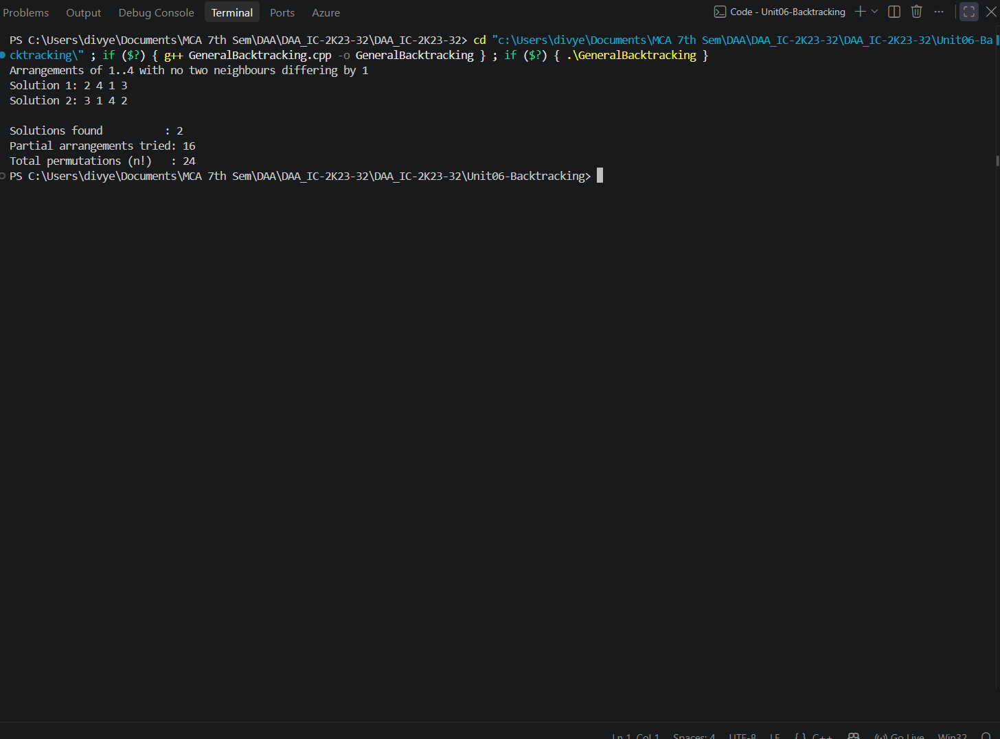
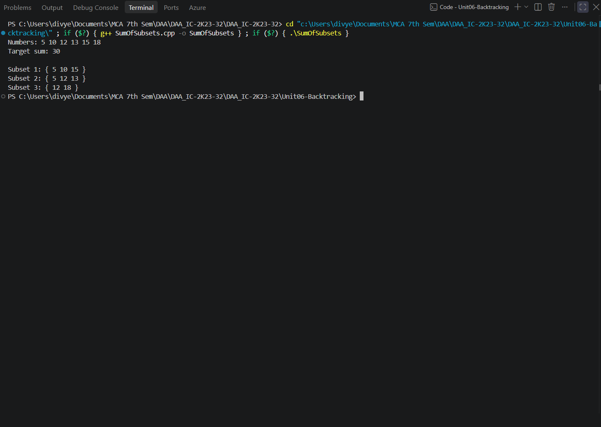
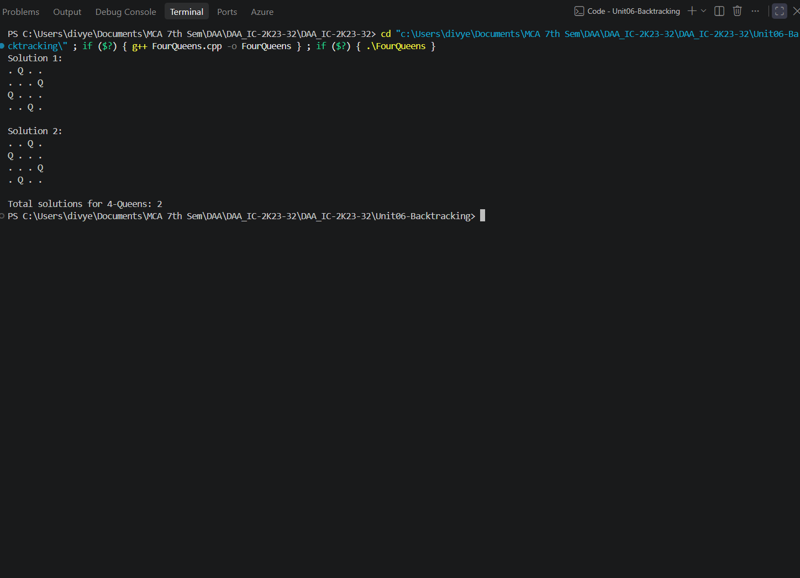
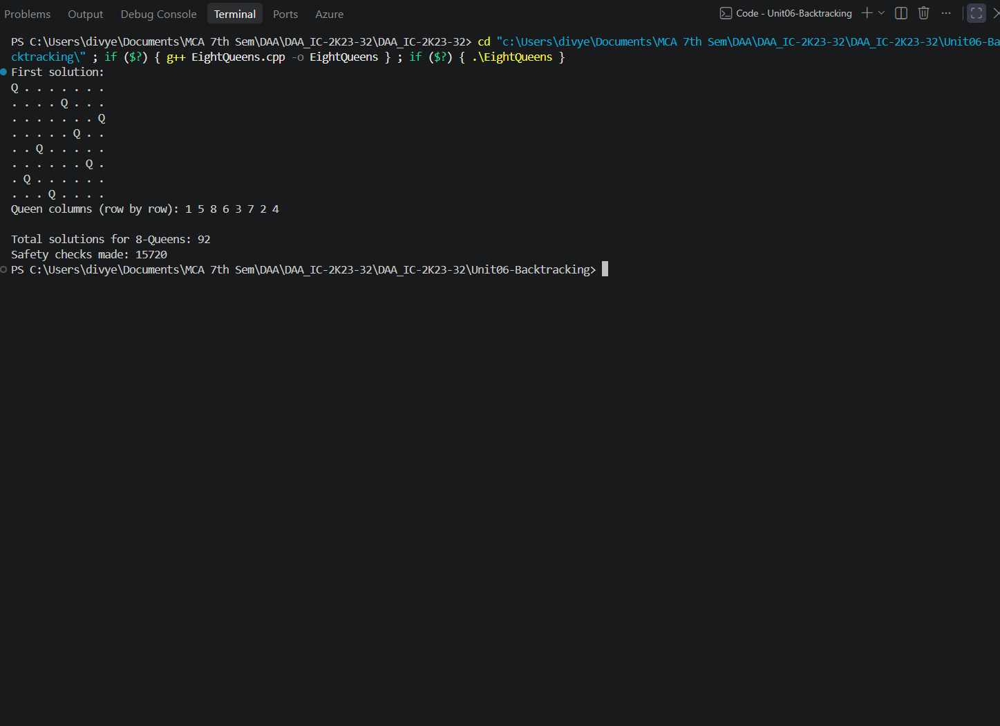
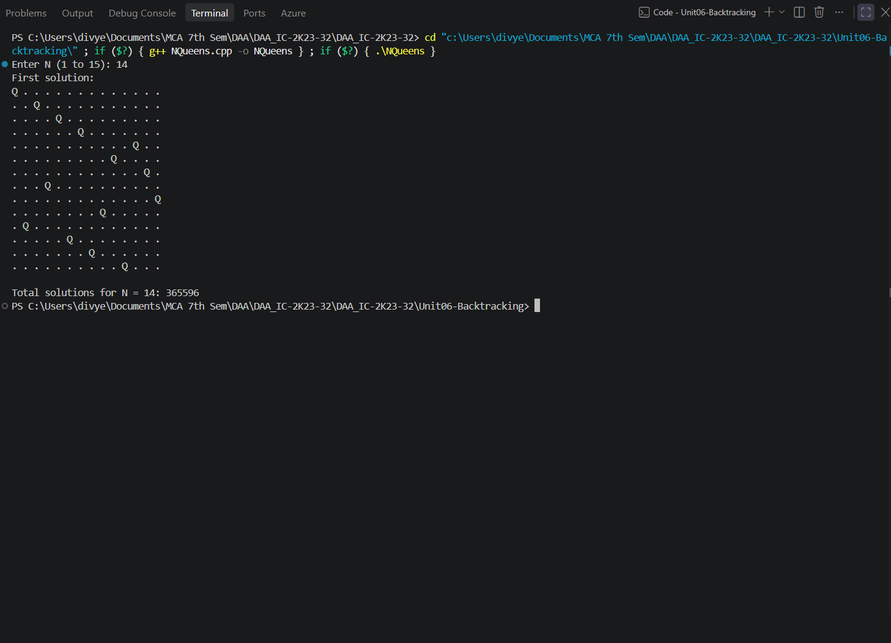

# Unit06-Backtracking

This unit demonstrates backtracking as a systematic search technique. Each program builds a partial solution, checks constraints, explores valid choices, and returns to earlier decisions when a branch cannot produce a solution.

## Programs

### General Backtracking Technique — `GeneralBacktracking.cpp`

**How it works:** Demonstrates the choose–explore–undo pattern. It constructs permutations of 1..n one position at a time and rejects a candidate if it is already used or differs by exactly 1 from the previous value.

- **Time complexity:** `O(n·n!) worst-case upper bound when checking candidates; pruning reduces explored states for this example`
- **Auxiliary space:** `O(n) for the current arrangement, used flags, and recursion depth`
- **Program behavior:** Uses n = 4; prints every valid arrangement, the number of solutions, partial arrangements tried, and n! total permutations.

**Sample output**



*Screenshot: `GeneralBacktracking.png`*

### Sum of Subsets — `SumOfSubsets.cpp`

**How it works:** Uses backtracking to decide whether to include or exclude each sorted number. It prunes branches when the current sum is too large or the remaining values cannot reach the target.

- **Time complexity:** `O(2ⁿ) worst case`
- **Auxiliary space:** `O(n) recursion and selection array`
- **Program behavior:** Uses numbers `{5, 10, 12, 13, 15, 18}` and target 30; prints every subset that sums exactly to the target.

**Sample output**



*Screenshot: `SumOfSubsets.png`*

### 4-Queens Problem — `FourQueens.cpp`

**How it works:** Places one queen in each row of a 4×4 board. Before placing a queen, it checks previously occupied columns and diagonals; unsafe choices are skipped and the search backtracks.

- **Time complexity:** `O(N!) upper-bound search with O(N) safety checks per placement`
- **Auxiliary space:** `O(N) for queen-column positions and recursion`
- **Program behavior:** Finds and prints every valid 4-Queens board and the total number of solutions.

**Sample output**



*Screenshot: `FourQueens.png`*

### 8-Queens Problem — `EightQueens.cpp`

**How it works:** Extends the same row-by-row backtracking strategy to an 8×8 board. It counts all solutions, prints only the first board, and counts calls to the safety-check function.

- **Time complexity:** `O(N!) upper-bound search with O(N) safety checks per placement`
- **Auxiliary space:** `O(N) for queen-column positions and recursion`
- **Program behavior:** Prints the first 8-Queens solution, queen columns by row, total solutions, and number of safety checks.

**Sample output**



*Screenshot: `EightQueens.png`*

### General N-Queens Problem — `NQueens.cpp`

**How it works:** Generalizes the N-Queens search. The user supplies N; the program places one queen per row and checks columns and diagonals before recursing. It prints the first solution and counts all solutions.

- **Time complexity:** `O(N!) upper-bound search with O(N) safety checks per placement`
- **Auxiliary space:** `O(N) for the position array and recursion`
- **Program behavior:** Prompts for N from 1 to 15, validates the input, prints the first valid board if one exists, and reports the total number of solutions.

**Sample output**



*Screenshot: `NQueens.png`*

## Compile and run

Compile each source file separately with a C++17 compiler. Run the command from the repository root (or adjust the relative path if you are already inside the unit folder).

```bash
g++ -std=c++17 path/to/Program.cpp -o program
./program
```

On Windows PowerShell:

```powershell
g++ -std=c++17 path/to/Program.cpp -o program.exe
.\program.exe
```

Replace `path/to/Program.cpp` with the required source-file path. Most programs use predefined sample data; `NQueens.cpp` asks the user to enter N.

## Notes

- Each `.cpp` file is a standalone program; compile it independently.
- Output screenshots are embedded from the unit's `outputs/` directory (or the relevant subfolder in Unit 5). Keep the image folders in place when moving or publishing the README.

## Important input note

`NQueens.cpp` accepts an input value from 1 to 15. The other programs use predefined examples in their source code.
