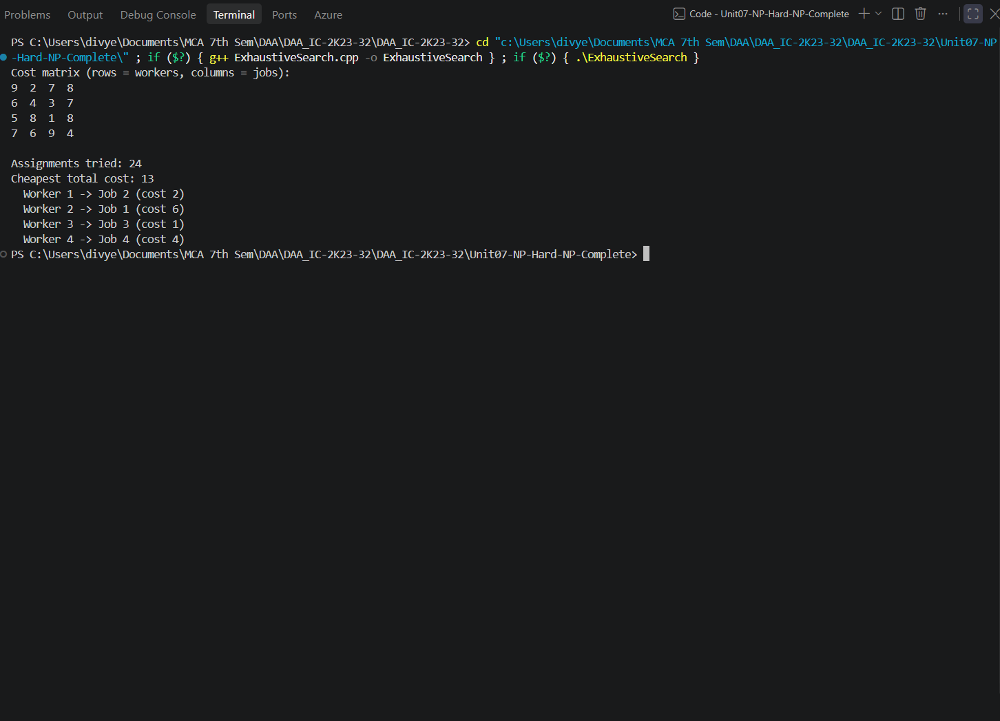
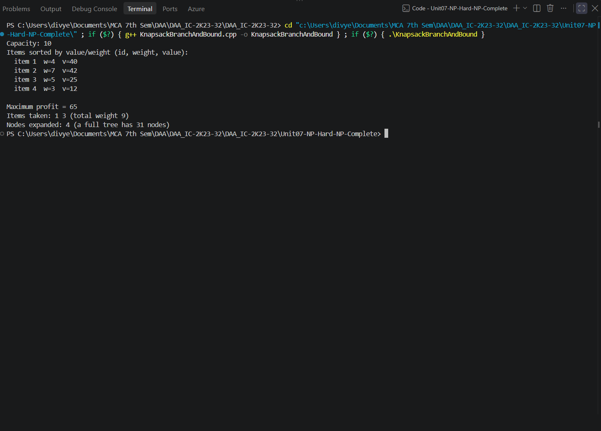
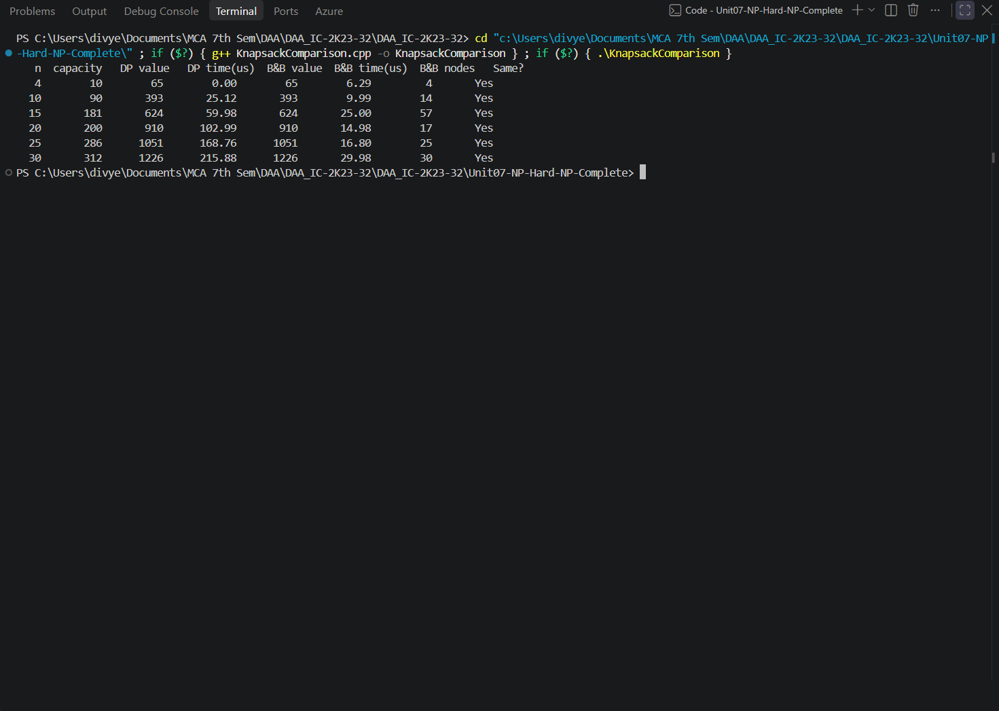
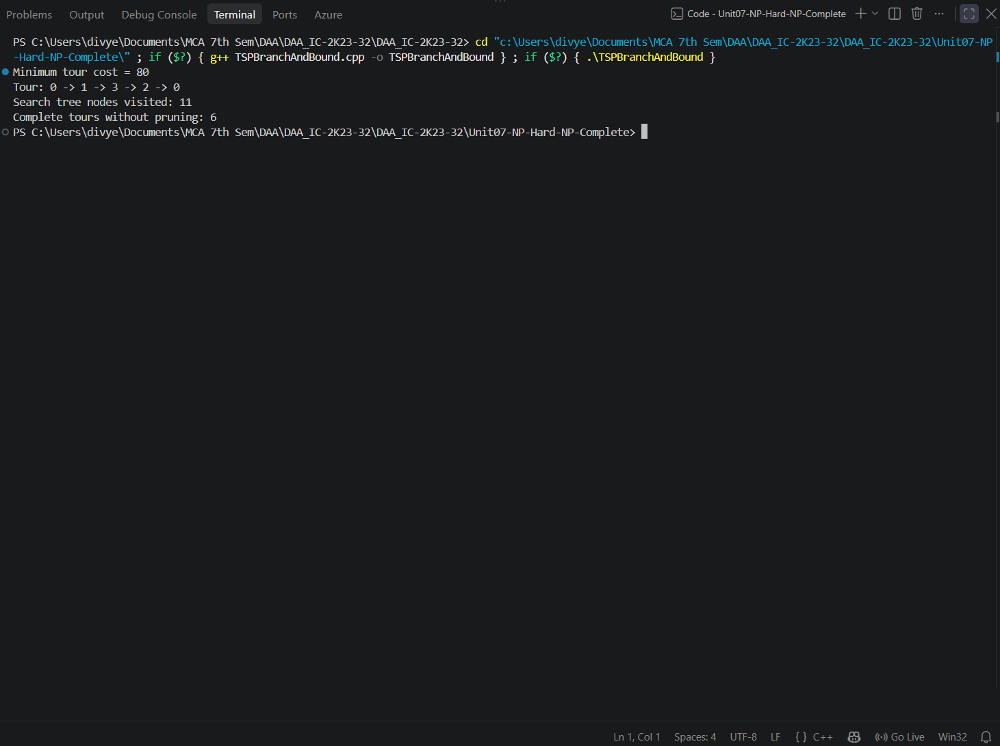
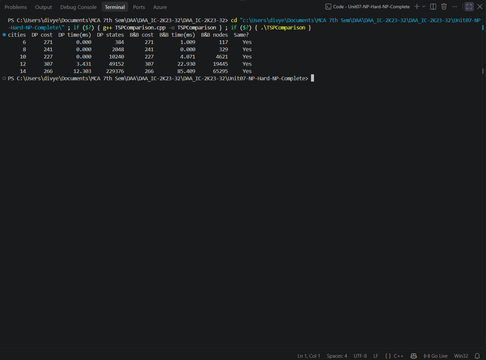

# Unit07-NP-Hard-NP-Complete

This unit explores computationally difficult optimization problems using exhaustive search and Branch and Bound. It also compares exact algorithms with different search strategies, including dynamic programming, to illustrate how pruning and state-space size affect practical performance.

## Programs

### Exhaustive Search — Assignment Problem — `ExhaustiveSearch.cpp`

**How it works:** Generates every permutation of job assignments using `next_permutation`. It calculates the total assignment cost for each permutation and retains the minimum-cost assignment.

- **Time complexity:** `O(n·n!) time`
- **Auxiliary space:** `O(n) for the permutation and best assignment arrays`
- **Program behavior:** Uses a predefined 4×4 worker/job cost matrix; checks all 4! assignments and prints the minimum total cost and worker-to-job mapping.

**Sample output**



*Screenshot: `ExhaustiveSearch.png`*

### 0/1 Knapsack using Branch and Bound — `KnapsackBranchAndBound.cpp`

**How it works:** Sorts items by value-to-weight ratio and explores include/exclude decisions in a priority queue ordered by an optimistic fractional-knapsack upper bound. Nodes whose bound cannot beat the best profit are pruned.

- **Time complexity:** `O(n·2ⁿ) worst-case upper bound including bound calculations, plus O(n log n) sorting`
- **Auxiliary space:** `O(2ⁿ) worst-case priority-queue storage`
- **Program behavior:** Uses 4 predefined items and capacity 10; prints items sorted by ratio, maximum profit, selected item IDs, total weight, and expanded-node count.

**Sample output**



*Screenshot: `KnapsackBranchAndBound.png`*

### 0/1 Knapsack Comparison — Dynamic Programming vs Branch and Bound — `KnapsackComparison.cpp`

**How it works:** Solves the same knapsack instances with a tabulation DP algorithm and a best-first Branch and Bound search. It measures average execution time over 200 repetitions, records B&B expanded nodes, and checks that both answers agree.

- **Time complexity:** `DP: O(nW); Branch and Bound: O(n·2ⁿ) worst case, plus O(n log n) sorting`
- **Auxiliary space:** `DP: O(nW); Branch and Bound: O(2ⁿ) worst-case queue storage`
- **Program behavior:** Compares both methods on one fixed 4-item example and deterministic generated cases with 10, 15, 20, 25, and 30 items. Prints capacities, answers, average times, B&B nodes, and answer-equality status.

**Sample output**



*Screenshot: `KnapsackComparison.png`*

### Travelling Salesperson Problem using Branch and Bound — `TSPBranchAndBound.cpp`

**How it works:** Builds a tour city by city. At each partial tour it computes a lower bound from the current cost and minimum outgoing edges; a branch is explored only if its bound can improve the best complete tour found so far.

- **Time complexity:** `O(n·n!) worst-case upper bound`
- **Auxiliary space:** `O(n) recursion depth and path/visited arrays`
- **Program behavior:** Uses a predefined 4-city symmetric distance matrix; prints the minimum tour cost, best tour, visited search-tree nodes, and number of complete tours without pruning.

**Sample output**



*Screenshot: `TSPBranchAndBound.png`*

### TSP Comparison — Held–Karp DP vs Branch and Bound — `TSPComparison.cpp`

**How it works:** Runs Held–Karp bitmask dynamic programming and a lower-bound Branch and Bound search on the same deterministic symmetric distance matrices. It compares minimum tour costs, execution times, DP state counts, and B&B nodes visited.

- **Time complexity:** `Held–Karp: O(n²·2ⁿ); Branch and Bound: O(n·n!) worst case`
- **Auxiliary space:** `Held–Karp: O(n·2ⁿ); Branch and Bound: O(n) recursion and search state (excluding matrix storage)`
- **Program behavior:** Generates test graphs for 6, 8, 10, 12, and 14 cities; prints both costs, timings, DP state counts, B&B node counts, and whether the answers match.

**Sample output**



*Screenshot: `TSPComparison.png`*

## Compile and run

Compile each source file separately with a C++17 compiler. Run the command from the repository root (or adjust the relative path if you are already inside the unit folder).

```bash
g++ -std=c++17 path/to/Program.cpp -o program
./program
```

On Windows PowerShell:

```powershell
g++ -std=c++17 path/to/Program.cpp -o program.exe
.\program.exe
```

Replace `path/to/Program.cpp` with the required source-file path. Most programs use predefined sample data; `NQueens.cpp` asks the user to enter N.

## Notes

- Each `.cpp` file is a standalone program; compile it independently.
- Output screenshots are embedded from the unit's `outputs/` directory (or the relevant subfolder in Unit 5). Keep the image folders in place when moving or publishing the README.

## Key concepts

- **Exhaustive search:** evaluates every candidate solution; it is straightforward but often factorial or exponential.
- **Branch and Bound:** explores a state-space tree and prunes a partial solution when its bound proves it cannot improve the current best solution.
- **NP-hard / NP-complete:** complexity classifications for problems and decision problems; the programs here are algorithmic demonstrations and do not perform formal complexity-class proofs.

## Complexity notation

- `n` = number of items, jobs, or cities; `W` = knapsack capacity.
